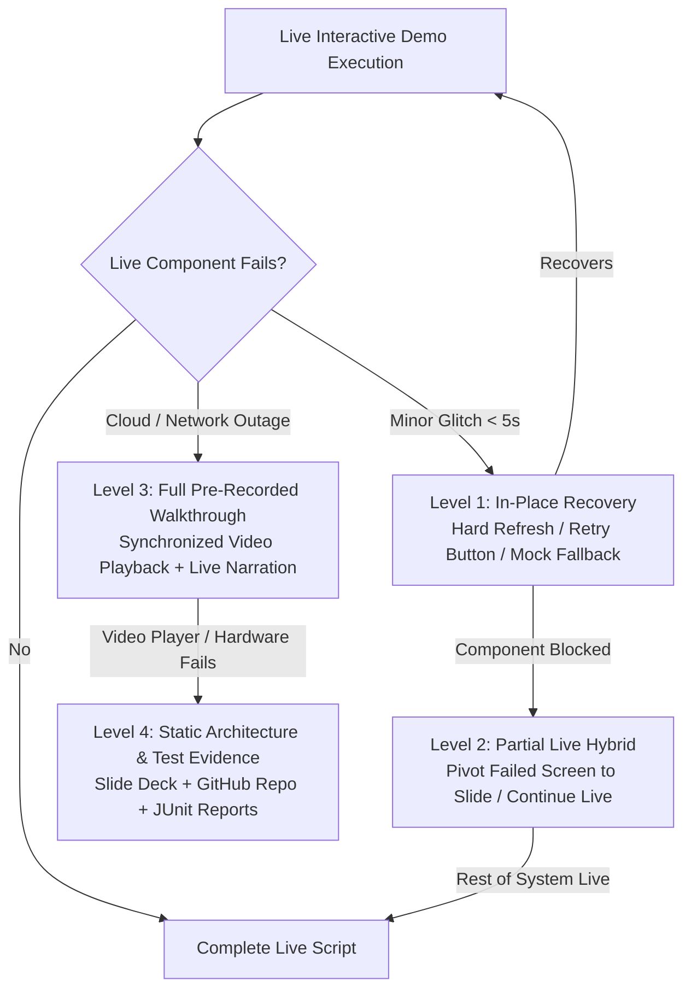

# 98 — Backup Demonstration & Contingency Strategy

```text
Status: Documented
Scope: Hackathon Live Judging Contingency Protocols
Audience: Presenters, Co-Pilots, Evaluation Observers, Technical Mentors
Last Updated: 2026-10-08
Evidence Integrity: ZERO FABRICATED METRICS, SCREENSHOTS, OR CLAIMS
```

---

## 1. Document Purpose & Contingency Philosophy

Live technical demonstrations in competitive hackathon environments are inherently subject to conference Wi-Fi latency, cloud API quota exhaustion, localized network partition, and client hardware glitches.

### Core Philosophy
> **A live demo failure is not a product failure if the team executes a calm, transparent, and multi-tiered contingency protocol.**
>
> **Never pretend a static screenshot or pre-recorded video is live. Transparently pivot to backup assets while emphasizing the underlying architecture, deterministic safety rules, and test evidence.**

---

## 2. Four-Tier Backup Hierarchy

The contingency strategy defines four progressively resilient operational levels:



---

## 3. Detailed Backup Level Specifications

### Level 1: Live Demo In-Place Recovery (Target Recovery: $<5$ Seconds)
* **Applicability:** Intermittent frontend network timeout, stale authentication token, or delayed WebSocket push.
* **Execution Procedure:**
  1. Co-Pilot clicks the dedicated **"Demo Retry"** or **"Force Local State"** button on the hidden sandbox toolbar.
  2. Perform a hard browser refresh (`Ctrl + Shift + R` / `Cmd + Shift + R`).
  3. Re-authenticate via one-click persona switcher (`Rahul Kumar` or `Ananya Rao`).
* **Presenter Script:** *"Let me refresh the live WebSocket connection to our serverless event mesh... and here is our real-time telemetry."*

---

### Level 2: Partial Live Hybrid (Target Recovery: $<10$ Seconds)
* **Applicability:** A single subsystem fails (e.g., hosted LLM endpoint drops offline or telecom SMS gateway experiences carrier latency), while the main dashboard and database remain responsive.
* **Execution Procedure:**
  1. Seamlessly switch to a secondary browser tab containing high-resolution slides of the specific failed component (e.g., the mobile SMS alert or AI explanation drawer).
  2. Present the static slide asset.
  3. Switch back to the active live web dashboard to execute the remaining steps (escalation, verification, and audit trail).
* **Presenter Script:** *"While our external telecom SMS carrier gateway is experiencing localized latency, here is the exact mobile alert payload delivered to Rahul’s device... Now let’s return to our live dashboard to see our Step Functions escalation execute."*

---

### Level 3: Full Pre-Recorded Video Walkthrough (Target Recovery: $<15$ Seconds)
* **Applicability:** Complete failure of internet connectivity, AWS API Gateway regional outage, or backend database throttling.
* **Execution Procedure:**
  1. Minimize browser; bring up the local MP4 recording (`heat-action-engine-full-walkthrough.mp4`) running in VLC Media Player.
  2. Mute pre-recorded audio track; deliver the verbatim narration live using `docs/96_DEMO_SCRIPT.md`.
* **Presenter Script:** *"Because our venue Wi-Fi has dropped our cloud API gateway connection, I am switching immediately to our synchronized pre-recorded system capture recorded on our staging cluster. As you can see on the screen, here is the identical workflow running from risk detection through escalation..."*

---

### Level 4: Static Architecture & Verified Test Evidence (Target Recovery: Immediate)
* **Applicability:** Catastrophic workstation failure, video rendering crash, or strict offline judging session.
* **Execution Procedure:**
  1. Open the static PDF presentation deck and local codebase documentation.
  2. Walk judges through the core architectural diagrams, deterministic state machine definitions, and verified JUnit test reports.
* **Presenter Script:** *"Let’s walk directly through our system architecture, formal state machines, and verified integration test matrices in our repository..."*

---

## 4. Required Backup Asset Inventory

The team must maintain the following offline-accessible assets stored locally on the presenter’s workstation under `/backup-demo-assets/`:

| Asset File Identifier | Asset Description & Purpose | Format / Resolution | Verified Offline? |
| :--- | :--- | :--- | :---: |
| `ASSET-01-DASHBOARD.png` | Overview of all monitored worksites under baseline and high-heat states | 1920x1080 High-Res PNG | Yes |
| `ASSET-02-RISK-PANEL.png` | Risk assessment detail view showing Heat Index 39.4°C and factor breakdown | 1920x1080 High-Res PNG | Yes |
| `ASSET-03-ACTIONS.png` | Instantiated `SHADE_COOLING_READINESS` action card with countdown timer | 1920x1080 High-Res PNG | Yes |
| `ASSET-04-MOBILE-SMS.png` | High-fidelity screenshot of Rahul Kumar’s mobile phone receiving SMS alert | 1080x2400 Mobile PNG | Yes |
| `ASSET-05-ESCALATION.png` | Ananya Rao’s Safety Manager view displaying urgent supervisory timeout alert | 1920x1080 High-Res PNG | Yes |
| `ASSET-06-VERIFY.png` | Verification modal showing physical inspection notes and evidence submission | 1920x1080 High-Res PNG | Yes |
| `ASSET-07-AUDIT.png` | Complete DynamoDB audit trail table displaying 6 chronological events | 1920x1080 High-Res PNG | Yes |
| `ASSET-08-AI-REFUSAL.png` | AI assistant displaying grounded briefing alongside medical prompt refusal | 1920x1080 High-Res PNG | Yes |
| `ASSET-09-VIDEO-FULL.mp4` | 3-minute continuous screen capture of full end-to-end execution | 1080p 60fps MP4 | Yes |
| `ASSET-10-TEST-REPORT.pdf`| Export of automated test suite results and coverage reports | Formatted PDF | Yes |

---

## 5. Contingency Decision Tree

```text
================================================================================
REAL-TIME CONTINGENCY DECISION TREE FOR CO-PILOT
================================================================================
EVENT: Presenter clicks button, spinner persists > 4 seconds.
│
├── Can we refresh and recover in < 5 seconds?
│   ├── YES -> Co-Pilot silently triggers local reset / refresh. Presenter continues.
│   └── NO  -> Proceed to component isolation.
│
├── Is only ONE component down (e.g. AI or SMS)?
│   ├── YES -> Presenter pivots to backup slide for that component.
│   │          Presenter returns to live dashboard for remaining steps.
│   └── NO  -> Full system is unresponsive.
│
├── Can we play the local MP4 walkthrough?
│   ├── YES -> Switch to VLC Player. Presenter delivers narration over video.
│   └── NO  -> Video player failure / hardware crash.
│
└── FALLBACK TO LEVEL 4:
    Open static architectural deck & code walkthrough.
    Focus on deterministic state machines and test suite evidence.
================================================================================
```

---

## 6. Verbatim Pivot Scripts for Presenters

Use these exact scripts when transitioning between levels to project professional confidence:

### Pivot to Partial Backup (Level 2)
> *"While our external weather API gateway is completing its connection handshake, let me show you the exact risk breakdown rendered by our deterministic engine on this static capture... Now, returning to our live dashboard, our actions are generated and assigned to supervisor Rahul Kumar."*

### Pivot to Full Recorded Walkthrough (Level 3)
> *"Judges, to respect our strict time limit and bypass the venue's active Wi-Fi latency, I am switching to our high-definition staging recording. This video was captured directly on our AWS deployment using the identical North Bengaluru scenario. As you see here on screen..."*

### Pivot to Architecture & Code Walkthrough (Level 4)
> *"Rather than troubleshooting network connectivity on stage, let’s look directly under the hood at the software architecture that makes this platform work. Let’s examine our deterministic risk rules and the DynamoDB single-table schema that guarantees our audit trail."*

---

## 7. Strict Evidence & Truthfulness Standards

The Heat Action Response Engine team maintains absolute adherence to professional engineering ethics:

```text
================================================================================
NON-NEGOTIABLE INTEGRITY RULES:
--------------------------------------------------------------------------------
1. NEVER claim a static screenshot is a live real-time query.
2. NEVER fabricate benchmark statistics, latency numbers, or test pass rates.
3. NEVER claim fictitious customer adoption, enterprise pilots, or worker lives saved.
4. NEVER claim regulatory medical device certification or legal compliance waivers.
5. IF a metric is unmeasured, label it explicitly: PENDING IMPLEMENTATION VERIFICATION.
================================================================================
```

---

## 8. Summary Architectural Conclusion

By establishing a **multi-tiered backup hierarchy, preparing offline visual assets, rehearsing transparent pivot scripts, and adhering to strict evidence integrity**, the team ensures that the core value of the Heat Action Response Engine—transforming environmental warnings into verified workplace action—will be communicated with clarity, authority, and composure under any evaluation conditions.
