# Heat Action Response Engine (HARE) — End-to-End System Architecture

**Project:** Heat Action Response Engine (HARE)  
**Tagline:** *From heat warning to verified workplace action.*  
**Live Application:** [http://hare-app-293951764497-sydney.s3-website-ap-southeast-2.amazonaws.com/](http://hare-app-293951764497-sydney.s3-website-ap-southeast-2.amazonaws.com/)  
**AWS Account:** `293951764497` • **Region:** `ap-southeast-2` (Sydney)

---

## 1. High-Fidelity Mermaid.js Architecture Diagram

```mermaid
flowchart TB
    %% STYLING DEFINITIONS
    classDef client fill:#e0f2fe,stroke:#0284c7,stroke-width:2px,color:#0f172a;
    classDef gateway fill:#ede9fe,stroke:#7c3aed,stroke-width:2px,color:#0f172a;
    classDef compute fill:#ffedd5,stroke:#ea580c,stroke-width:2px,color:#0f172a;
    classDef storage fill:#dcfce7,stroke:#16a34a,stroke-width:2px,color:#0f172a;
    classDef external fill:#f1f5f9,stroke:#64748b,stroke-width:2px,color:#0f172a;
    classDef workflow fill:#fce7f3,stroke:#db2777,stroke-width:2px,color:#0f172a;
    classDef ai fill:#fae8ff,stroke:#a855f7,stroke-width:2px,color:#0f172a;
    classDef ops fill:#fef9c3,stroke:#ca8a04,stroke-width:2px,color:#0f172a;

    %% 1. CLIENT / USER LAYER
    subgraph TIER1 [" 1. CLIENT PRESENTATION LAYER "]
        direction TB
        USER1["👷 Site Supervisor<br/>(Rahul Kumar • Site Scope)"]:::client
        USER2["🦺 Regional Safety Mgr<br/>(Ananya Rao • Multi-Site)"]:::client
        USER3["⚙️ System Administrator<br/>(Vikram Singh • Enterprise)"]:::client
        S3["🪣 Amazon S3 Static Hosting<br/>(React 18 + TS Single Page App)<br/><i>hare-app-293951764497-sydney</i>"]:::client
    end

    %% 2. INGRESS & API GATEWAY
    subgraph TIER2 [" 2. API INGRESS & ROUTING LAYER "]
        APIGW["⚡ Amazon API Gateway (HTTP API v2)<br/>HTTPS CORS Proxy • Strict Routing<br/><i>5k8d4lhgc6.execute-api.ap-southeast-2</i>"]:::gateway
    end

    %% 3. SERVERLESS BACKEND COMPUTE
    subgraph TIER3 [" 3. SERVERLESS CORE BACKEND COMPUTE LAYER "]
        direction TB
        LAMBDA["λ AWS Lambda (Node.js 20.x • 512MB • 30s)<br/>Express Serverless REST API Engine<br/><i>hare-backend-api</i>"]:::compute
        
        subgraph MODULES [" Core Execution Engines "]
            AUTH["🔐 RBAC Auth Service<br/>(JWT Tokens • Scope Guard)"]:::compute
            RISK["🌡️ Deterministic Heat Risk Engine<br/>(v1.0.0 Rule Matrix • sWBGT Proxy)"]:::compute
            ACTION["📋 Action Lifecycle Engine<br/>(SOP Templates • Deduplication)"]:::compute
            AUDIT["🔒 Audit Ledger Service<br/>(SHA-256 Hash Chaining)"]:::compute
        end
        LAMBDA --- MODULES
    end

    %% 4. EDGE WORKER
    subgraph TIER_EDGE [" EDGE COMPUTING "]
        EC2["💻 Amazon EC2 Edge Worker<br/>(t3.micro • AL2023 • 3.106.130.183)<br/><i>HARE-Edge-Safety-Worker</i>"]:::compute
    end

    %% 5. EXTERNAL INGESTION & AI
    subgraph TIER_EXT [" 4. EXTERNAL DATA & AI LAYER "]
        OPENMETEO["🌦️ Open-Meteo Weather API<br/>(Hourly Ingestion • UTC Normalized)"]:::external
        BEDROCK["🧠 Amazon Bedrock<br/>• Titan Embeddings V2<br/>• Nova Micro (Assistive Summaries)"]:::ai
        NVIDIA["✨ NVIDIA NIM (Assistive AI)<br/>(Llama 3.2 11B Vision Instruct)"]:::ai
    end

    %% 6. DURABLE DATA & PERSISTENCE
    subgraph TIER4 [" 5. DURABLE DATA PERSISTENCE LAYER "]
        direction TB
        DDB_OPS["🗄️ DynamoDB: HARE-OperationalTable<br/>(Actions • Statuses • Assignments)"]:::storage
        DDB_TEL["🗄️ DynamoDB: HARE-TelemetryTable<br/>(Historical Microclimate Observations)"]:::storage
        DDB_AUD["🗄️ DynamoDB: HARE-AuditTable<br/>(Immutable Chained Audit Blocks)"]:::storage
        RDS["🐘 Amazon RDS PostgreSQL 18.3<br/>(hare-relational-db • 20GB gp2)"]:::storage
    end

    %% 7. WORKFLOW ORCHESTRATION & NOTIFICATIONS
    subgraph TIER5 [" 6. WORKFLOW ORCHESTRATION & ALERTS "]
        direction TB
        SFN["🔄 AWS Step Functions State Machine<br/>(HARE-SupervisorEscalation-StateMachine)<br/><i>30-sec SLA Countdown & Callback</i>"]:::workflow
        SNS["📢 Amazon SNS Topics<br/>• hare-emergency-heat-alerts<br/>• hare-escalation-breaches"]:::workflow
        EVENTBRIDGE["⏰ Amazon EventBridge<br/>(15-Minute Telemetry Ingest Cron)<br/><i>heat-action-event-bus</i>"]:::workflow
    end

    %% 8. GOVERNANCE & OBSERVABILITY
    subgraph TIER6 [" 7. GOVERNANCE & MONITORING LAYER "]
        CW["📊 Amazon CloudWatch<br/>• /aws/lambda/hare-backend-api<br/>• HARE-Operational-Cockpit<br/>• HARE-LambdaErrors-Alarm"]:::ops
        BUDGET["💰 AWS Budgets<br/>($50.00/mo Credit Guardrail)"]:::ops
        SSM["🔑 AWS Systems Manager<br/>(/hare/config/* Parameters)"]:::ops
    end

    %% CONNECTIONS & FLOWS
    USER1 -->|HTTP HTTPS| S3
    USER2 -->|HTTP HTTPS| S3
    USER3 -->|HTTP HTTPS| S3
    
    S3 -.->|REST API Calls| APIGW
    APIGW -->|Proxy Payload| LAMBDA
    
    EC2 -.->|Telemetry Relay| APIGW
    
    LAMBDA <-->|Fetch Live Weather| OPENMETEO
    LAMBDA <-->|Non-Authoritative Context| BEDROCK
    LAMBDA <-->|Assistive Q&A| NVIDIA
    
    LAMBDA -->|Write / Query| DDB_OPS
    LAMBDA -->|Ingest Telemetry| DDB_TEL
    LAMBDA -->|Append Hash Chained Events| DDB_AUD
    LAMBDA -->|Archive Compliance Records| RDS
    
    LAMBDA -->|Trigger SLA Workflow| SFN
    SFN -->|SLA Breach Event| SNS
    SNS -->|Urgent Dispatch| USER2
    
    EVENTBRIDGE -->|Trigger 15-min Polling| LAMBDA
    
    LAMBDA -.->|Emit Logs & Metrics| CW
    LAMBDA -.->|Load Secrets| SSM
```



---

## 2. Architectural Tier Breakdown & Explanations

### Tier 1: Client & Presentation Layer
* **Amazon S3 (`hare-app-293951764497-sydney`):** Hosts the production React 18 single-page application built with Vite and TypeScript. Configured with website hosting and CORS policies.
* **Role-Based Dynamic Workspaces:**
  1. **Site Supervisor Workspace (Rahul Kumar):** Worksite scope locked to `WS-BLR-NORTH-04`. Displays actionable priority queue; enables assignment acknowledgment, work tracking, blocker reporting, and completion submissions.
  2. **Regional Safety Command Center (Ananya Rao):** Unlocked multi-site scope across all 19 regional logistics facilities. Features SLA breach escalation resolution and official human verification review.
  3. **Enterprise Administration Workspace (Vikram Singh):** Provides complete compliance audit log inspection, system health probes, and cloud topology status.

### Tier 2: Ingress & API Routing Layer
* **Amazon API Gateway (HTTP API v2 `5k8d4lhgc6`):**
  * Serves as the secure HTTPS entry point with ultra-low latency.
  * Handles pre-flight `OPTIONS` requests, request validation, and forwards all requests to the Lambda backend via a greedy proxy (`/{proxy+}`).

### Tier 3: Serverless Backend Compute Layer
* **AWS Lambda (`hare-backend-api`):**
  * Node.js 20.x runtime packaged via `@codegenie/serverless-express`.
  * **Deterministic Risk Engine (v1.0.0):** Authoritative rule matrix implementing OSHA NEP, NOAA Heat Index, and simplified Wet-Bulb Globe Temperature (sWBGT). **AI is never in the authoritative risk decision path.**
  * **Action Lifecycle Engine:** Transforms heat risks into actionable SOP directives (hydration station refills, shaded rest cycles, misting activation) with deduplication against active in-flight items.
  * **Audit Ledger Service:** Implements cryptographic SHA-256 hash chaining ensuring tamper-evident provenance for regulatory compliance.

### Tier 4: External Ingestion & AI Layer
* **Open-Meteo Weather API:** Ingests live dry-bulb temperature, relative humidity, direct normal solar irradiance, and wind velocity in UTC.
* **Amazon Bedrock & NVIDIA NIM (Assistive AI):**
  * Models: `amazon.titan-embed-text-v2:0` (text embeddings), `amazon.nova-micro-v1:0` (safety summaries), `meta/llama-3.2-11b-vision-instruct`.
  * **Strict Safety Invariant:** AI is strictly assistive (summarizing instructions, translating alerts) and cannot alter risk levels or cancel escalations.

### Tier 5: Durable Data Persistence Layer
* **Amazon DynamoDB (On-Demand Capacity):**
  * `HARE-OperationalTable`: Stores actions, assignments, statuses, and worksite configs with Global Secondary Indexes (`GSI1`) for fast supervisor queries.
  * `HARE-TelemetryTable`: Archives weather inputs.
  * `HARE-AuditTable`: Immutably logs state transitions.
* **Amazon RDS PostgreSQL (`hare-relational-db`):**
  * Provisioned PostgreSQL 18.3 (`db.t3.micro`, 20GB gp2) for relational regulatory queries.

### Tier 6: Workflow Orchestration & Messaging Layer
* **AWS Step Functions (`HARE-SupervisorEscalation-StateMachine`):**
  * Orchestrates the 30-second acknowledgment countdown SLA.
  * Re-reads the database state upon timeout. If unacknowledged, triggers an automated breach alert.
* **Amazon SNS Topics:**
  * `hare-emergency-heat-alerts`: High-priority heat hazard alerts.
  * `hare-escalation-breaches`: Dispatches escalation alerts to the Regional Safety Manager.
* **Amazon EventBridge:**
  * Runs a 15-minute cron rule (`hare-weather-ingest-schedule`) invoking the Lambda API to refresh microclimate telemetry.

### Tier 7: Governance & Observability Layer
* **Amazon CloudWatch:** Real-time log streams, `HARE-Operational-Cockpit` dashboard, and `HARE-LambdaErrors-Alarm`.
* **AWS Budgets:** `HARE-Hackathon-Safety-Budget` ($50.00 USD/month) protecting the account against budget overruns.
* **AWS Systems Manager (SSM) Parameter Store:** Centralizes `/hare/config/*` settings.

---

## 3. End-to-End Operational Lifecycle Sequence

```
[1. WEATHER SIGNAL]
       │  (Open-Meteo Ingestion via EventBridge 15-min Cron)
       ▼
[2. DETERMINISTIC RISK EVALUATION]
       │  (Backend Engine evaluates Rule Matrix: Low, Moderate, High, Critical)
       ▼
[3. ACTION GENERATION & DEDUPLICATION]
       │  (Generates SOP: act_chilled_water_refill assigned to Rahul Kumar)
       ▼
[4. SLA COUNTDOWN INITIATED]
       │  (AWS Step Functions 30-sec timer begins)
       ├─────────────────────────────────────────┐
       │ (Supervisor acknowledges)               │ (Missed deadline / Blocker)
       ▼                                         ▼
[5. ACTION ACKNOWLEDGED]               [6. SLA BREACH ESCALATED]
       │                                         │
       │ (Field execution & notes)               │ (Amazon SNS alert dispatched)
       ▼                                         ▼
[7. COMPLETION SUBMITTED]              [8. SAFETY MGR RESOLUTION]
       │                                         │
       └────────────────────┬────────────────────┘
                            ▼
                [9. HUMAN VERIFICATION]
         (Safety Manager Ananya Rao inspects & verifies)
                            ▼
              [10. TERMINAL STATUS: VERIFIED]
                            ▼
            [11. SHA-256 AUDIT LEDGER ENTRY]
           (Cryptographic Hash Chained & Immutable)
```

---

## 4. Prompt to Generate Professional Draw.io Architecture Diagram in Gemini

Copy and paste the exact prompt below into Google Gemini to generate a Draw.io XML architectural diagram or an editable visual representation:

```text
Act as a Principal AWS Solutions Architect and enterprise diagram designer.

Please generate a complete, professional, publication-quality AWS Architecture Diagram for the "Heat Action Response Engine (HARE)" platform. 

Provide the diagram in two formats:
1. Valid, importable Draw.io XML format (enclosed in a ```xml code block) that can be pasted directly into Draw.io (Diagrams.net) via Arrange > Insert > Advanced > XML.
2. A clean PlantUML or ASCII architectural layout.

Here is the exact technical architecture to represent:

PROJECT: Heat Action Response Engine (HARE)
TAGLINE: From heat warning to verified workplace action.
AWS ACCOUNT: 293951764497 | REGION: ap-southeast-2 (Sydney, Australia)

TIERS AND COMPONENTS TO INCLUDE:
1. CLIENT PRESENTATION LAYER:
   - 3 User Personas: Site Supervisor (Rahul Kumar), Regional Safety Manager (Ananya Rao), System Admin (Vikram Singh)
   - Amazon S3 Bucket: hare-app-293951764497-sydney (Static Website Hosting React 18 + TypeScript SPA)

2. API INGRESS & ROUTING LAYER:
   - Amazon API Gateway HTTP API v2 (Endpoint: 5k8d4lhgc6.execute-api.ap-southeast-2.amazonaws.com) with CORS and JWT bearer auth validation.

3. SERVERLESS BACKEND COMPUTE LAYER:
   - AWS Lambda Function: hare-backend-api (Node.js 20.x, Serverless Express, 512MB RAM, 30s timeout)
   - Core Sub-Modules inside Lambda:
     * RBAC Authentication & Worksite Scoping Engine
     * Authoritative Deterministic Heat Risk Engine (v1.0.0 Rule Matrix)
     * Preventive Action Lifecycle Engine
     * SHA-256 Cryptographic Hash-Chaining Audit Service

4. EDGE COMPUTE:
   - Amazon EC2 Instance: HARE-Edge-Safety-Worker (Instance ID: i-0c6453f7986631915, t3.micro, Amazon Linux 2023, Public IP: 3.106.130.183) for on-site IoT telemetry relay.

5. EXTERNAL TELEMETRY & ASSISTIVE AI:
   - Open-Meteo Weather API (Hourly UTC Ingestion)
   - Amazon Bedrock (Titan Text Embeddings V2 & Amazon Nova Micro)
   - NVIDIA NIM (Meta Llama 3.2 11B Vision Instruct) - strictly marked as Assistive (Non-Authoritative)

6. DATA PERSISTENCE LAYER:
   - Amazon DynamoDB (On-Demand capacity):
     * HARE-OperationalTable (Actions, Assignments, Worksite Geometry)
     * HARE-TelemetryTable (Atmospheric Observations)
     * HARE-AuditTable (Immutable SHA-256 Chained Event Blocks)
   - Amazon RDS: hare-relational-db (PostgreSQL 18.3, db.t3.micro, 20GB gp2) for regulatory reporting.

7. WORKFLOW ORCHESTRATION & NOTIFICATIONS:
   - AWS Step Functions State Machine: HARE-SupervisorEscalation-StateMachine (30-second SLA callback countdown)
   - Amazon SNS Topics: hare-emergency-heat-alerts and hare-escalation-breaches
   - Amazon EventBridge: Custom bus heat-action-event-bus and rule hare-weather-ingest-schedule (rate: 15 minutes)

8. OBSERVABILITY & GOVERNANCE:
   - Amazon CloudWatch: Log group /aws/lambda/hare-backend-api, Dashboard HARE-Operational-Cockpit, Alarm HARE-LambdaErrors-Alarm
   - AWS Budgets: HARE-Hackathon-Safety-Budget ($50.00/month limit)
   - AWS SSM Parameter Store: /hare/config/*

DESIGN STYLE INSTRUCTIONS:
- Use standard AWS 2024 architecture icon styles, colors, and clean rounded container boxes.
- Group services logically into labelled horizontal/vertical swimlanes: Presentation Tier, Ingress Tier, Compute Tier, Storage Tier, Workflow & Messaging Tier, and Monitoring Tier.
- Use distinct color coding for arrows: Blue for REST HTTPS traffic, Green for Data persistence, Red/Orange for SLA breach alerts, and Purple for Event/Workflow orchestration.
- Make the diagram clean, balanced, and ready for an executive enterprise hackathon presentation.
```
